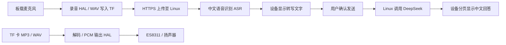

> 2026-10-19：本文保留首版范围；后台播放、耳机接口与线控已纳入[后续音频迭代计划](audio-roadmap.zh-CN.md)，尚未开发完成。

> 2026-10-04 修复更新：录音音量换算、音频通道独占、MP3 16kHz重采样、AI首次说明后自动问答及上下文追问已实现，固件已刷入；服务器上下文两轮公网测试通过。当前操作以 [设备说明](reader-ai-device.zh-CN.md) 为准。

> 2026-10-03 更新：设备端 AI 应用、HTTPS 客户端、录音上传确认、转写确认、回答分页、历史与恢复已实现；服务器部署与真实 ASR/DeepSeek 联调待完成。当前实现及配置以 [设备端说明](reader-ai-device.zh-CN.md) 为准。录音与回放已由用户实测正常，音乐独立为应用菜单入口。下文保留早期方案，标注“未实现”的 AI 内容已由本更新取代。

# 微雪 3.97 音频与语音问答技术方案

日期：2026-10-03。状态：开发中；Waveshare 音频应用已有 WAV 录音/回放与 MP3 解码代码。固件已通过串口直刷到 ESP32-S3 并进入 CrossMux UI，音频质量尚未实测。设备端 AI 应用/网络客户端仍未实现；服务器工作按用户要求暂缓。

基线：CrossMux `23dc182ca9d5ac2fa910be3cdc49ff50684142cc`；FreeInk SDK `96de1be6ce08eb732909e6e8149af8f892b9a2c5`。此源码版本与设备此前安装的 `4868cb9` Nightly 不同，先验证基线再叠加功能。

本地拉取注意：SDK同时跟踪 `MetalioEInk4Board.h` 和 `MetalioEink4Board.h`。当前Mac文件系统无法独立表示这两个仅大小写不同的文件，首次检出即出现一个SDK文件被修改的状态，并非本轮人为改动。编译前应使用大小写敏感的工作卷或Linux文件系统重新检出，不能把该差异提交或当作功能修改。容器直接挂载这个Mac目录并不能消除底层文件名冲突。

## 1. 范围与不可退让的要求

- 保留基线全部现有功能、中文、多语言、微信读书、AirPage、游戏、主题、文件传输、蓝牙翻页、阅读进度、设置和升级能力；不通过删功能腾空间。
- 新增两个应用菜单入口：**录音与音乐**、**AI 问答**（现名 **dogzclaw**）。两者均与微信读书、AirPage 同级，不嵌入微信读书页面。
- 本地录音、录音回放、TF 卡 MP3 播放离线工作。
- dogzclaw 采用语音输入、识别文字确认、DeepSeek 回答、墨水屏分页显示。
- 不新增待办或电子便签，不改用户现有 Linux → AirPage 推送服务。
- 第一版不包含后台音乐、边录边播、语音唤醒、自动朗读、在线音乐。现有功能保持可访问，新增音频应用退出时结束音频任务。
- 先针对微雪 3.97 启用新增音频能力；其他硬件不增加常驻音频资源，现有共享功能不回退。

## 2. 源码证据与改动位置

以下行号对应上述基线；链接指向本地源码，实施时需复核。

| 事实 | 证据 | 设计决策 |
|---|---|---|
| 微信读书和 AirPage 在同一应用注册表 | [AppsMenuActivity.cpp](../src/activities/apps/AppsMenuActivity.cpp)，32–53 行 | 追加两个应用条目，复用现有主题、可见性设置和导航 |
| 应用 ID 是持久化位号，当前使用 0–16 | [AppVisibility.h](../src/AppVisibility.h)，7–35 行 | 拟追加 17、18，实施时确认未被上游占用，不能重排旧 ID |
| HAL 目前只暴露 PCM 播放、重启、音量和关闭 | [HalAudioOutput.h](../lib/hal/HalAudioOutput.h)，6–14 行 | 新增音频会话控制及输入 HAL，应用不得绕过 HAL |
| SDK 支持 16 位 PCM/WAV 播放 | [AudioManager.h](../freeink-sdk/libs/hardware/AudioManager/include/AudioManager.h)，57–76 行 | 复用输出后端；MP3 解码接入 PCM，不重复初始化 I²S |
| SDK 原先没有为此板启用麦克风采集 | [AudioManager.cpp](../freeink-sdk/libs/hardware/AudioManager/src/AudioManager.cpp)，Waveshare profile 原先未配置 DIN | 已核对微雪原理图和官方示例：板载模拟麦克风进入 ES8311 ADC，I²S DIN 接 GPIO21；首段实现使用专用 16 kHz 输入通道 |
| 微雪板有专用构建和 AudioManager 依赖 | [platformio.ini](../platformio.ini)，765–802 行 | 增加专用开发构建，保留原始环境作对照 |
| 当前双 OTA 槽各 0x640000 字节 | [partitions.csv](../partitions.csv)，4–7 行 | 先测量构建余量，再决定是否迁移分区 |
| 功能键已有单击、双击、长按映射 | [板卡说明](engineering/waveshare-epaper-397.md)，23–36 行 | 使用逻辑按键，录音采取“确认开始、再次确认停止”，不抢 BOOT/PWR 长按 |

## 3. 设备与 Linux 服务架构

推荐使用用户现有 Linux 服务器。文字问答可以由 ESP32 直连 DeepSeek，但语音链路需要 ASR，集中在服务器更方便限额、重试、密钥管理和供应商切换。

Linux 服务独立部署，例如单独容器和路径 `/reader-ai/v1/`；不依赖或修改现有 AirPage 服务。应用服务器不直接暴露到公网，由现有反向代理终止 HTTPS。最终域名、服务器资源、部署方式和 ASR 供应商待确认。

### ASR 选择

- 推荐第一版用支持普通话的托管 ASR，由服务器适配；是否支持口音、标点、录音格式以及地区访问要通过真实样本确认。需要独立服务凭据和费用，不假设 DeepSeek Key 可用于 ASR。
- 如果服务器资源足够，也可部署本地 ASR；CPU/GPU、内存和并发未知，不能承诺识别速度。先测 10/30/60 秒中文录音，再选择实现。
- DeepSeek 使用官方聊天 API，模型名可配置，不固化可能过时的型号。开发板不运行大模型。第一版只显示回答，不依赖 TTS。
- 本地录音默认不上传；只有进入 dogzclaw 并提交录音才上传。第一版不自动上传书籍或阅读上下文。

### API 合约与服务实现

所有接口要求设备级 Bearer Token，上传与新建问答支持 `Idempotency-Key`。设备只保存可撤销 Token；DeepSeek 和 ASR 密钥保存在服务器密钥文件/环境中，禁止写入固件、TF 卡、日志和代码仓库。

| 接口 | 请求/行为 | 响应 |
|---|---|---|
| `GET /reader-ai/v1/health` | 认证后查询能力和协议版本 | ASR/问答是否可用，不返回密钥 |
| `POST /reader-ai/v1/transcriptions` | 流式上传 `audio/wav`；16kHz/16位/单声道，首版最长60秒 | `202 {job_id,state}` |
| `GET /reader-ai/v1/jobs/{id}` | 2秒起轮询，退避至5秒；前台等待总限时120秒 | `queued/transcribing/awaiting_confirmation/generating/completed/failed/cancelled`、错误码、结果游标 |
| `GET /reader-ai/v1/jobs/{id}/result?cursor=...` | 获取有界 UTF-8 内容片段 | 文本、next_cursor、done；不以字节切断字符 |
| `POST /reader-ai/v1/questions` | 转写任务 ID、确认后的文字、可选会话 ID | `202 {job_id}`；未确认不得自动调用 DeepSeek |
| `DELETE /reader-ai/v1/jobs/{id}` | 尽力取消当前设备任务；任务数据在24小时内过期 | 已运行的上游请求可能仍产生费用 |

建议初始限制：上传上限2 MiB，问题最多2000个Unicode字符，答案最多8000字符，会话最多6轮并做总上下文限额。超限给出明确错误，不无声截断。结果按最多2 KiB UTF-8片段传输，设备保存到TF卡后分页。以上是设计值，实测可调整。

首版等待服务器完成整段回答，再分页获取，不在屏幕逐 token 刷新；后续才考虑增量段落。断网后保留 job_id，可恢复查询；幂等键与请求摘要绑定，避免重复上传造成重复计费。服务重启需能恢复任务状态，不能仅依赖进程内队列。

服务端按设备隔离任务、限制并发/日额度/文件大小/录音时长，校验 WAV 真正格式，禁止设备指定任意上游 URL。TLS 必须校验证书与主机名，设备校时后连接，不关闭校验。音频在转写完成后删除，失败残留最长24小时；问答结果建议24小时后过期，设备本地历史可单独删除。日志只记录任务 ID、耗时、状态和计量，不记录完整语音、文本或密钥。云 ASR/DeepSeek 的数据处理条款另行核对。

## 4. 音频实现与资源生命周期

统一音频所有权：`Idle → Recording / WavPlayback / Mp3Playback → Stopping → Idle`。提示音、播放器、录音不能各自建立一套 I²S/codec 实例。

- 录音期间暂停按键提示音和功放，避免录入提示声；播放期间不让提示音抢占音乐。退出后恢复原设置，绝不永久关闭提示音功能。
- 录音默认16kHz、16位、单声道PCM WAV，约1.92 MB/分钟。建议本地录音单段最长30分钟，AI提问最长60秒；界面显示限制。
- 流式写入 `.part` 临时文件；停止时补齐 WAV 长度、同步并改名。断电残留按完整采样帧恢复，保存恢复标记，不能宣称硬断电零丢失。
- MP3 首段代码使用 Espressif `esp_audio_codec` v2.6.2 的 ESP32-S3 静态库，经 Waveshare 专用 PlatformIO 脚本链接；以固定大小输入/PCM 缓冲流式解码，跳过 ID3v2 tag，不把封面载入内存，并将 16 位单/双声道 PCM 送入现有 I²S HAL。许可证随组件保留。CBR/VBR、采样率、坏文件恢复和播放稳定性尚未上板实测；遇到不受支持的格式时要干净报错。非 UTF-8 文件名显示回退仍待检查。
- 首版支持播放/暂停、上一首/下一首、音量；VBR 时长未知时显示“时长未知”，先不承诺精确拖动定位。解码库依据许可证、构建兼容和测试文件选择，暂不锁定。
- 所有 SD 访问走 `HalStorage`，避免读写与阅读、网页传输并发破坏存储状态。USB Drive 接管卡前必须关闭音频文件、停止任务。
- 建议PCM环形缓冲32–64 KiB、压缩输入8–16 KiB，属于待测预算；活动进入时一次性申请，退出释放，不在热路径反复分配。大缓冲优先PSRAM；DMA缓冲使用驱动要求的内存能力，不能假定PSRAM可直接DMA。
- I²S任务只处理数据，不绘制UI、不调用网络；UI读取有界状态快照。停止先通知并等待任务退出，再关闭文件/驱动和释放内存，避免强杀持锁任务。
- 录音和播放保持必要CPU频率，不阻止用户主动关机；关机先停止并保存，空闲恢复节能。AI录音结束后再启用上传，避免同时占用音频和TLS峰值内存。

## 5. 固件容量与升级兼容

此前安装的应用约5.96 MiB，不能用它代替当前基线的构建测量。当前 Waveshare 编译已通过，MP3 接入后应用槽占用 6,368,311 / 6,553,600 字节（97.2%），余量约 185 KiB。串口直刷已用于本次实机启动验证；它绕过 OTA 更新流程，但仍受 app0 分区容量限制。AI 客户端仍会增加固件体积，后续开发前需重新评估当前分区；还要记录设备运行时的内部堆、最大空闲块、PSRAM和任务栈高水位。

优先保持原分区和双OTA槽；通过资源去重、资源外置等不删功能的方式评估余量。若仍不足，再设计微雪专用更大双槽布局，但必须先审计 SPIFFS 实际用途、占用和持久化数据，不能直接缩小或覆盖。不能用“16MB总容量够”代替OTA槽检查。

分区变更需要显式迁移包、原有设置导出与恢复、完整USB安装和回退验证；普通OTA不能承担分区迁移。定制固件要有独立版本后缀、发布清单及更新源，保留OTA功能，同时防止自动升级到官方版导致新增功能消失。禁止把定制包误发布给其他板型。

## 6. 阶段与验收

| 阶段 | 交付 | 进入下一阶段条件 |
|---|---|---|
| A 基线 | 可重复构建、资源报告、原功能清单 | 中文阅读、微信读书、AirPage、主题、USB/Wi-Fi、蓝牙、设置/进度、休眠和升级基线确认 |
| B 音频验证 | WAV录音与回放、硬件输入接线证据 | 真实录音清楚、无明显削波/丢帧，10分钟录音与关机恢复通过 |
| C 应用UI | 录音与音乐应用、MP3列表和播放 | 中文文件名、CBR/VBR、连续30分钟播放、频繁进入退出、SD满/缺卡/损坏文件处理通过 |
| D 服务器 | 标准库 API、认证、任务队列和可配置 ASR / DeepSeek 适配已实现 | 用实际 ASR 凭据完成中文样本、限额、超时、取消、重启及隔离验证 |
| E 端到端 | 语音提问→确认文字→回答→历史 | 20轮真实问答、断网恢复、失败后不重复计费请求、中文分页、返回阅读通过 |
| F 发布 | 完整功能回归、包校验、OTA及回退 | 全部原功能可用，Flash预算合格，无持续堆下降；记录续航实测，不提前承诺 |

建议回归目标：音频应用开关100次后无持续内存下降；大字库/大EPUB阅读正常；屏幕刷新不导致录音明显丢帧；原应用可见性及设置保持；语音服务不可用不影响离线阅读。精确延迟和功耗门槛在基线测试后确定。

仅文档阶段不运行固件测试。后续按仓库要求执行相关主机测试、微雪编译与共享代码回归；模拟器只验证UI和状态，不能证明音频、电源、SD并发及显示波形稳定。

## 7. 实施前待确认

服务器操作系统、CPU/内存/GPU、容器环境、反向代理和公网域名；是否愿意使用付费云ASR；电池和扬声器实际连接；当前CrossMux“不太对”的具体表现。可以先开展本地音频与UI开发，不因服务器信息未齐而阻塞。

DeepSeek官方参考：https://api-docs.deepseek.com/ 。只确认聊天接口；不能据此推断支持ASR或TTS。

操作流程与线框见 [操作和UI方案](audio-voice-operations.zh-CN.md)。
